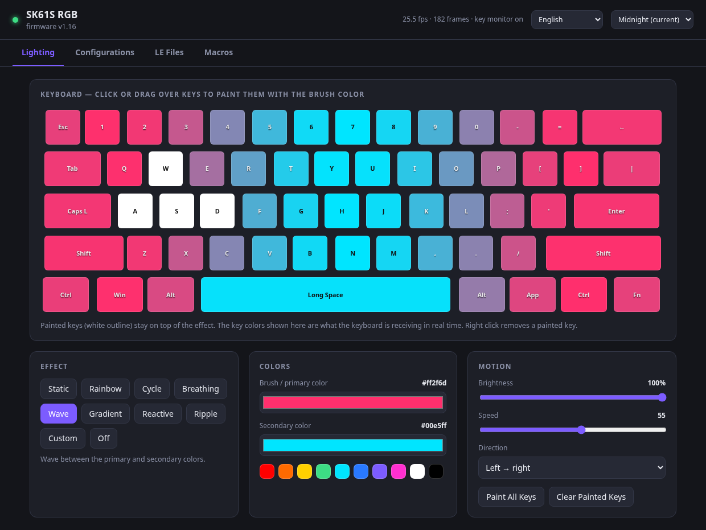
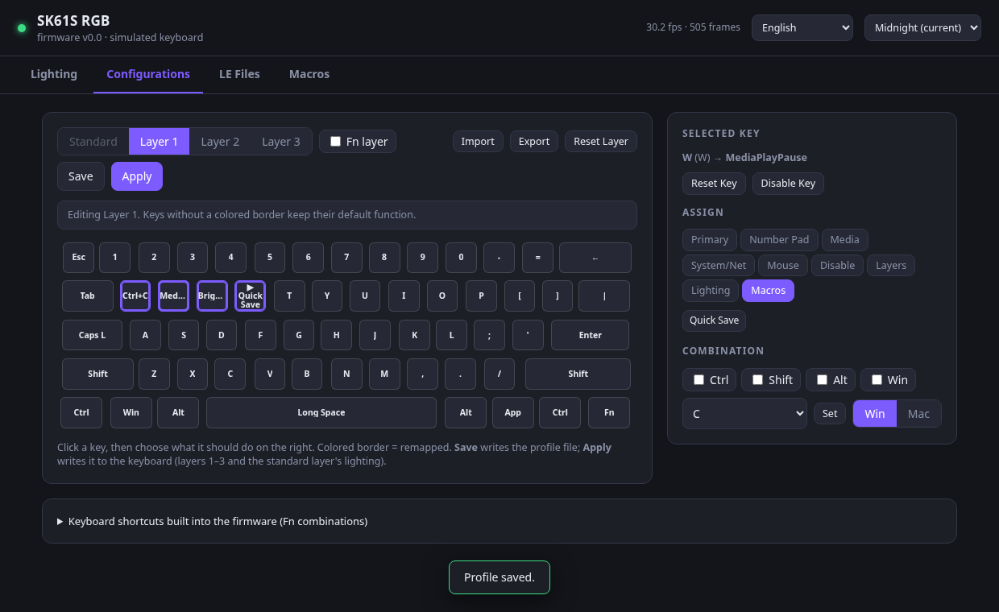
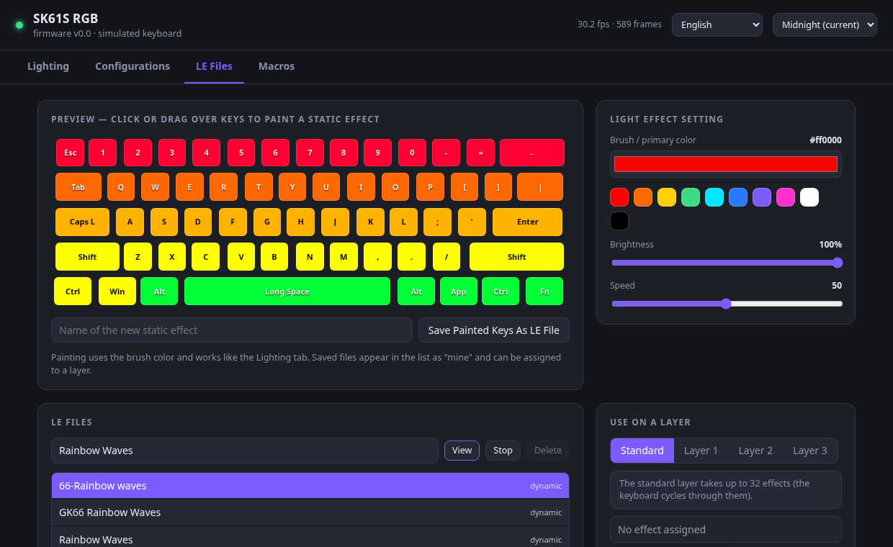
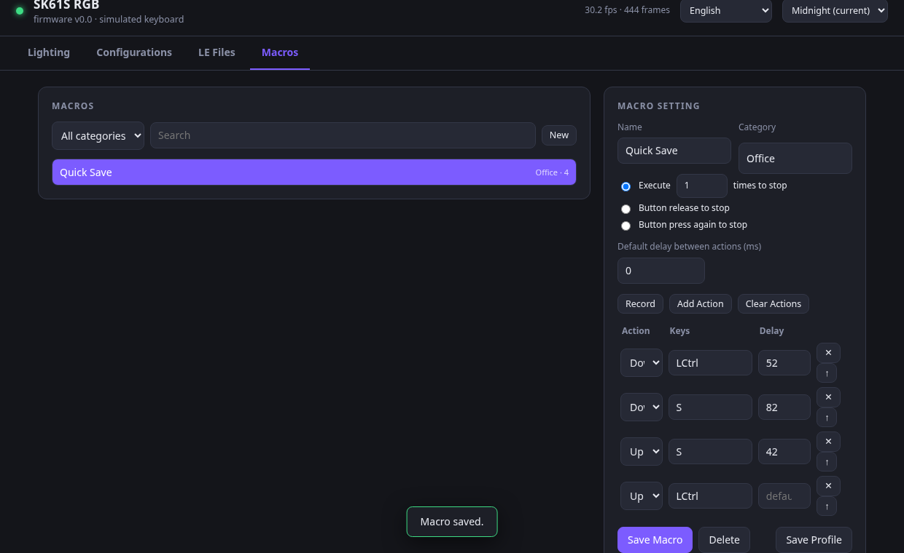

# GK6X for Linux (native, realtime lighting)

This branch turns GK6X into a native Linux program:

- Runs on **.NET 8+** (no mono, no Wine, no `sudo`): `gk6x` command, systemd user service, desktop launcher.
- **Realtime lighting**: a small service drives the keyboard's "driver" layer frame by frame (30 fps) so colors
  and effects change instantly. Control it from the command line or from a browser page with a live keyboard preview.
- Everything from the original tool (`map`, `unmap`, `findkeys`, key/macro/lighting files) still works, now with the
  settings in `~/.config/gk6x` instead of next to the program.

Supported: the same keyboards as upstream (GK61, GK64, GK68, GK84, GK87, SK61, ... USB id `1ea7:0907`).



*Control page (`gk6x ui`) on a SK61S RGB: the keys show the colors the keyboard is receiving in real time; click or drag to paint keys.*

The page has a theme picker (top right): Midnight, Neon, Carbon, Aurora, Clean light, Material You and Classic; it is remembered by the browser, or use `?theme=aurora` in the URL.

> **Status of realtime lighting:** the driver-layer protocol (`0x1A` frames) was reverse engineered by the upstream author but
> never implemented in the open source tool. It is implemented here and **verified on a SK61S RGB** (colors, rainbow,
> reactive effect and normal typing all work). Other models should behave the same; run `gk6x probe` to check yours.

## Control page

`gk6x ui` opens the control page (also in the app menu). Four tabs, modelled on the official software's screens:

**Lighting** - realtime effects, per-key painting, colors, speed, brightness (this is the live preview of what the keyboard receives).

**Configurations** - remap keys per layer (Layer 1-3, each with its Fn layer). Pick a key, then choose a function from the
palette (Primary, Number Pad, Media, System/Net, Mouse, Disable, Layers, Lighting, Macros) or build a combination such as
Ctrl+Shift+A (Win/Mac naming toggle). **Save** writes `~/.config/gk6x/UserData/MODELID.txt`, **Apply** writes the layer to the
keyboard. **Import / Export** exchange that file. The standard layer is protected (the official software doesn't allow
remapping it either); only its lighting can be set.



**LE Files** - the 300+ lighting effects shipped with the official software, searchable. **View** plays one on your keyboard
in realtime (software approximation of the firmware animation), **Add to layer** + **Apply** stores it in the keyboard
(up to 32 on the standard layer, one on the other layers). Paint keys on the preview and **Save** them as your own static LE file.



**Macros** - create macros with categories and search. **Record** captures the keys you press in the page (with timing), or add
actions by hand (Press / Down / Up + delay). Repeat modes: N times, until the key is released, or until it is pressed again.
Assign a macro to a key in Configurations -> Macros, then Apply.



The page speaks English and Portuguese (selector in the header) and has seven themes.

Extra key functions available in the palette (all firmware features): next lighting effect / reactive effect, brightness and
speed up/down, lighting pause, lighting on/off, lock the Windows key, hold-to-switch layer, layer buttons. Firmware shortcuts
you can use without any software (from the Epomaker / Skyloong SK61-GK61 manuals): Fn+Backspace backlight on/off, Fn+P / Fn+[
brightness -/+, Fn+] next mode, Fn+Q/W/E/R driver layer / layer 1 / 2 / 3.

Files: profile `~/.config/gk6x/UserData/MODELID.txt` (original GK6X text format, a `.bak` copy is kept on save), your own
lighting files `~/.config/gk6x/UserData/lighting/*.le`, realtime settings `~/.config/gk6x/realtime.json`.

## Install (step by step)

1. Install the .NET SDK and git:
   - Arch / CachyOS: `sudo pacman -S dotnet-sdk git`
   - Fedora: `sudo dnf install dotnet-sdk-8.0 git`
   - Ubuntu / Debian: `sudo apt install dotnet-sdk-8.0 git`
2. Get the code and install:
   ```sh
   git clone https://github.com/nergalzin/GK6X-Linux.git
   cd GK6X-Linux
   ./linux/install.sh            # add --autostart to start the lighting service at every login
   ```
   Run it as your normal user. It asks for your password **once**, only to install the udev rule
   (`/etc/udev/rules.d/70-gk6x.rules`) that lets your desktop user talk to the keyboard.
3. Unplug and replug the keyboard once (only if the next step says it can't open the device).
4. Check the keyboard is seen and that lighting works:
   ```sh
   gk6x list        # every line should end with open=yes
   gk6x probe       # lights all keys red for 5 seconds, then returns to normal
   ```
   `~/.local/bin` must be in your `PATH` (the installer warns if it isn't):
   - bash/zsh: add `export PATH="$HOME/.local/bin:$PATH"` to `~/.bashrc` / `~/.zshrc`
   - fish: `fish_add_path ~/.local/bin`

   Then open a new terminal.
5. Start the service and open the control page:
   ```sh
   systemctl --user start gk6x      # or just: gk6x daemon
   gk6x ui                          # opens the control page in its own window (http://127.0.0.1:6465)
   ```

## Using it

`gk6x ui` (and the "GK6X Lighting" menu entry) opens the page as a standalone app window using a Chromium-based browser (Brave, Chrome, Chromium, Vivaldi, Edge...), with no tabs or address bar. It starts the service if needed. Use `gk6x ui --tab` for a normal browser tab, or set `GK6X_BROWSER=/path/to/browser` to pick the browser. Without a Chromium-based browser it falls back to `xdg-open`.

```sh
gk6x color ff0000                    # solid red
gk6x effect rainbow --speed 60
gk6x effect wave --color ff0040 --color2 00ffd0 --dir 0
gk6x effect reactive --color ffffff --color2 101030     # keys flash when pressed
gk6x brightness 70
gk6x key W 00ff00                    # paint a single key (name, label or #locationCode)
gk6x key W off                       # unpaint it
gk6x clear                           # unpaint everything
gk6x off
gk6x status
gk6x stop                            # stop the service; the keyboard goes back to its normal layer
```

Effects: `static`, `rainbow`, `cycle`, `breathing`, `wave`, `gradient`, `reactive`, `ripple`, `custom` (only painted keys), `off`.
Your last settings are saved to `~/.config/gk6x/realtime.json` and restored on the next start.

`reactive` / `ripple` read the keyboard's standard HID interface (read only, nothing is grabbed or blocked).
Disable with `gk6x daemon --no-key-monitor` if you don't want that.

Key mapping, macros and the saved per-layer lighting are the original commands. Run `gk6x` with no arguments for the
prompt (`map`, `unmap`, `findkeys`, `dumpkeys`...). Your files live in `~/.config/gk6x/UserData/` (see `Sample.txt`).

## Update

```sh
cd GK6X-Linux && git pull && ./linux/install.sh
```
Your settings in `~/.config/gk6x` are kept.

## Uninstall

```sh
./linux/uninstall.sh            # program, service, launcher, udev rule (keeps your settings)
./linux/uninstall.sh --purge    # ...and deletes ~/.config/gk6x and the logs
```
The keyboard keeps the key mapping last written to it. Use the reset key combo from its manual (or `gk6x` → `unmap`) to
restore the defaults.

## Troubleshooting

| Symptom | Fix |
|---|---|
| `gk6x list` says `open=NO` | Replug the keyboard after installing the udev rule; make sure you're logged in on the local desktop session (the rule uses `uaccess`). |
| `gk6x probe`: "NO ANSWER" on a step | Try `gk6x probe --driver-keys none`, and send the output together with your model name. |
| Keys type nothing while the service runs | Run `gk6x stop` (or unplug/replug). Then try `gk6x daemon --driver-keys none`. |
| Keyboard stays dark / colors wrong | Open an issue with your model. Frames are R,G,B + alpha per LED; alpha must be 255 (0 = LED off). |
| Logs | `~/.local/state/gk6x/KbLog.txt` and `journalctl --user -u gk6x` |

Do **not** use the upstream README's udev rule `SUBSYSTEM=="input", GROUP="input", MODE="0666"`: it makes *every* input
device on the machine world readable/writable (a keylogger for any local user). The rule shipped here only touches this
keyboard's `hidraw` nodes.

## How realtime lighting works

- The keyboard has a "driver" layer which is normally driven by the vendor software. `gk6x daemon` switches the keyboard to it
  (op `0x0B 05`), loads default key values so typing keeps working (op `0x16 01`), then sends 132 × RGBA values
  (one per LED, indexed by the key `LocationCode`) as ten 56-byte HID reports (op `0x1A 01`) followed by a "commit" (op `0x1A 02`). The 4th byte of each LED is alpha and must be 255.
- The keyboard also needs a real ping (op `0x0C`) at least every ~0.5 s, otherwise it stops answering frames after ~5 s.
- A frame is only sent when it changed (plus a 1 s keep-alive); the keyboard is pinged by the existing keep-alive thread.
- On stop it returns the keyboard to its base layer.

Local control API (127.0.0.1 only, JSON): `GET /api/state`, `POST /api/settings`, `POST /api/paint`, `POST /api/shutdown`.

## Developing

```sh
cd GK6X && dotnet build -c Release     # output in ../Build
cd ../Build
dotnet GK6X.dll selftest                # offline protocol + effect checks
dotnet GK6X.dll daemon --simulate       # UI without a keyboard
```
