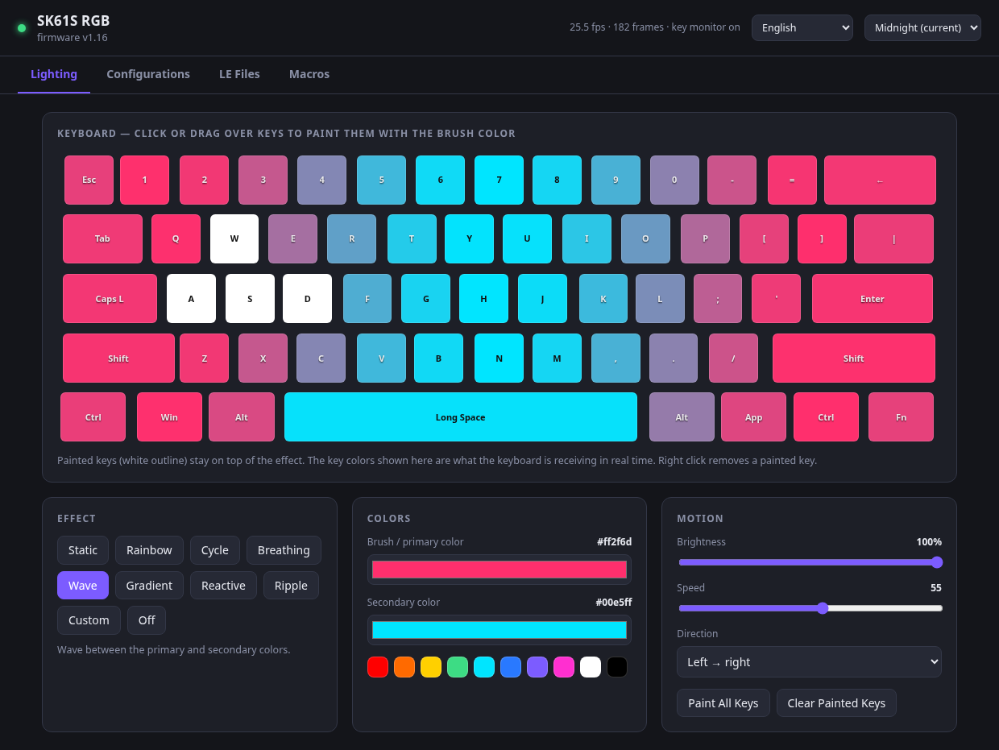
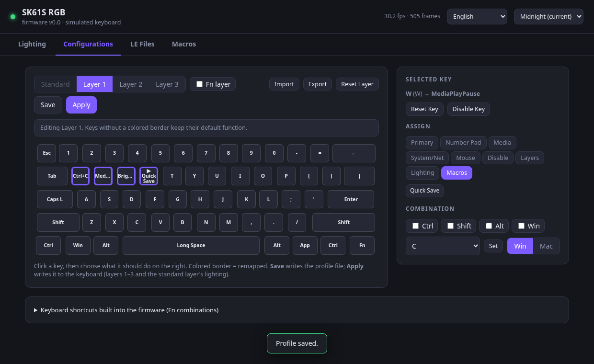
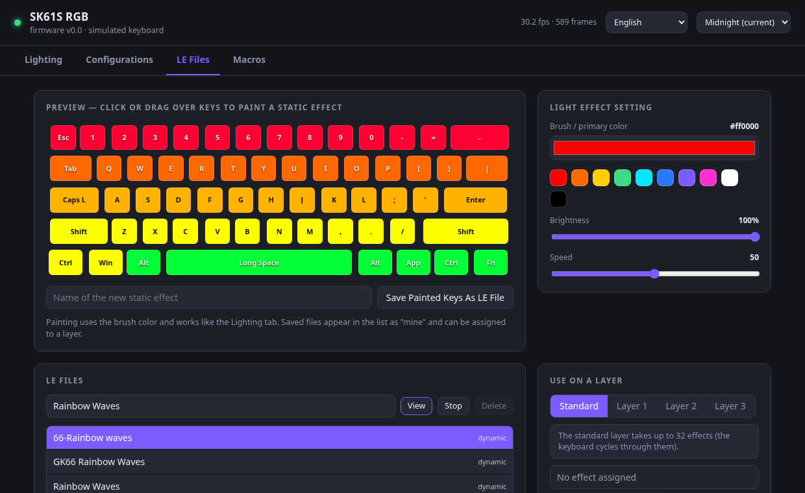
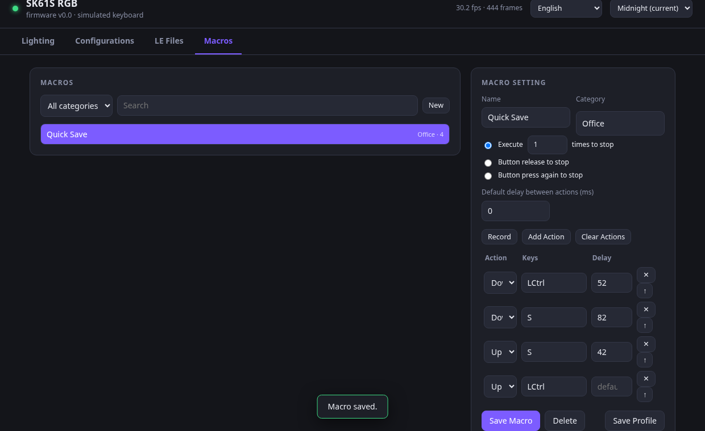

# GK6X for Linux (native)

This fork runs natively on Linux (.NET 8, no mono, no `sudo`) and adds **realtime RGB lighting**: change colors and effects
instantly from the command line or from a web page with a live keyboard preview. Tested on a SK61S RGB; key mapping,
macros and the original commands still work.

Fork of [pixeltris/GK6X](https://github.com/pixeltris/GK6X) (MIT license, archived upstream).



*Control page (`gk6x ui`) on a SK61S RGB: the keys show the colors the keyboard is receiving in real time; click or drag to paint keys.*

The page has a theme picker (top right): Midnight, Neon, Carbon, Aurora, Clean light, Material You and Classic. Your choice is remembered by the browser (or open `http://127.0.0.1:6465/?theme=aurora`).

## Control page

`gk6x ui` opens the control page (also in the app menu). Four tabs, modelled on the official software's screens:

**Lighting** - realtime effects, per-key painting, colors, speed, brightness (this is the live preview of what the keyboard receives).

**Configurations** - remap keys per layer (Layer 1-3, each with its Fn layer). Pick a key, then choose a function from the
palette (Primary, Number Pad, Media, System/Net, Mouse, Disable, Layers, Lighting, Macros) or build a combination such as
Ctrl+Shift+A (Win/Mac naming toggle). **Save** writes `~/.config/gk6x/UserData/MODELID.txt`, **Apply** writes the layer to the
keyboard. **Import / Export** exchange that file. The standard layer is protected (the official software doesn't allow
remapping it either); only its lighting can be set.



**LE Files** - the 300+ lighting effects shipped with the official software, searchable. **View** plays one on your keyboard
in realtime (software approximation of the firmware animation), **Add to layer** + **Apply** stores it in the keyboard
(up to 32 on the standard layer, one on the other layers). Paint keys on the preview and **Save** them as your own static LE file.



**Macros** - create macros with categories and search. **Record** captures the keys you press in the page (with timing), or add
actions by hand (Press / Down / Up + delay). Repeat modes: N times, until the key is released, or until it is pressed again.
Assign a macro to a key in Configurations -> Macros, then Apply.



The page speaks English and Portuguese (selector in the header) and has seven themes.

Extra key functions available in the palette (all firmware features): next lighting effect / reactive effect, brightness and
speed up/down, lighting pause, lighting on/off, lock the Windows key, hold-to-switch layer, layer buttons. Firmware shortcuts
you can use without any software (from the Epomaker / Skyloong SK61-GK61 manuals): Fn+Backspace backlight on/off, Fn+P / Fn+[
brightness -/+, Fn+] next mode, Fn+Q/W/E/R driver layer / layer 1 / 2 / 3.

Files: profile `~/.config/gk6x/UserData/MODELID.txt` (original GK6X text format, a `.bak` copy is kept on save), your own
lighting files `~/.config/gk6x/UserData/lighting/*.le`, realtime settings `~/.config/gk6x/realtime.json`.

## Install

1. Install the .NET SDK and git (Arch/CachyOS: `sudo pacman -S dotnet-sdk git`, Fedora: `sudo dnf install dotnet-sdk-8.0 git`, Ubuntu: `sudo apt install dotnet-sdk-8.0 git`).
2. Get the code and run the installer as your normal user (it asks for your password once, only for the udev rule):
   ```sh
   git clone https://github.com/nergalzin/GK6X-Linux.git && cd GK6X-Linux
   ./linux/install.sh --autostart      # --autostart = start the lighting service at every login
   ```
3. Make sure `~/.local/bin` is in your `PATH` (fish: `fish_add_path ~/.local/bin`) and replug the keyboard if it isn't detected.
4. Check it: `gk6x list` (every line should say `open=yes`), then `gk6x status`.

## Use

```sh
gk6x color ff0000                  # solid color
gk6x effect rainbow --speed 60     # static, rainbow, cycle, breathing, wave, gradient, reactive, ripple, custom, off
gk6x key W 00ff00                  # paint one key ('off' removes it); gk6x clear removes all
gk6x brightness 70
gk6x ui                            # control page in its own window (also in the app menu); --tab = browser tab
gk6x stop                          # keyboard goes back to its normal layer
```
Key mapping and macros: run `gk6x` with no arguments (`map`, `unmap`, `findkeys`...); your files live in `~/.config/gk6x/UserData/`.

## Update

```sh
cd GK6X-Linux && git pull && ./linux/install.sh --no-udev --autostart
systemctl --user start gk6x
```
Your settings in `~/.config/gk6x` are kept.

## Uninstall

```sh
./linux/uninstall.sh            # program, service, launcher, udev rule (keeps your settings)
./linux/uninstall.sh --purge    # also deletes ~/.config/gk6x and logs
```

Full documentation, how it works and troubleshooting: [README-LINUX.md](README-LINUX.md).

---

# Original README (upstream, archived)

Project archived on 2026-03-05. I've made a release updating the data files to V6.0.0.76 on this date but no GUI build due to issues. This release provides compatibility with keyboards such as GK68 but hasn't been tested thoroughly. If you're having issues try the GK6X-v1.21 release instead. It's recommended to use the official software which is linked below. This project is no longer maintained as I no longer use any GK6X based keyboards.

# GK6X

This is a command-line tool for mapping keys, macros, and lighting for GK6X keyboards (GK64, GK84, GK61, etc). This can be used as an alternative to the official software ([Windows](http://www.jikedingzhi.com/downloadlist?driverID=41) / [Mac](http://www.jikedingzhi.com/downloadlist?driverID=90)).

It runs on Windows, Mac, and Linux.

## System requirements / compilation

See the [releases](https://github.com/pixeltris/GK6X/releases) page for prebuilt binaries.

<details>
<summary>.NET Framework 4+ on Windows. mono on Mac / Linux. Expand for more info.</summary>

### Windows

.NET Framework 4+ is required (should be pre-installed on Windows 7 and higher).

To compile from source you have two options:
- Run `GK6X/GK6X.bat`
- Compile using Visual Studio (C# tools required)

### Linux / Mac

[mono](https://www.mono-project.com/download/stable/) is required (most Linux package managers should list `mono-complete`).

Compiling may take several attempts depending on the version of mono. Try `xbuild GK6X.sln`, or `msbuild GK6X.sln`, or `xbuild /p:TargetFrameworkVersion=v4.5 /p:TargetFrameworkProfile=""`, or ask for help in [#4](https://github.com/pixeltris/GK6X/issues/4).

`cd` into `Build` and run with `sudo mono GK6X.exe`. Super user (`sudo`) is required on Linux ([possible hidraw issue]( https://github.com/pixeltris/GK6X/issues/3)). Or use the udev rule below.

### Linux AUR package

GK6X is available in [AUR](https://wiki.archlinux.org/title/Arch_User_Repository) as package [gk6x-bin](https://aur.archlinux.org/packages/gk6x-bin/) maintained by [@aakashhemadri](https://github.com/aakashhemadri).

### Linux `sudo` alternative (udev rule)

An alternative to using `sudo` is to set up a udev rule. Create `/etc/udev/rules.d/gk6x.rules`:

```
SUBSYSTEM=="input", GROUP="input", MODE="0666"
SUBSYSTEM=="usb", ATTRS{idVendor}=="1ea7", ATTRS{idProduct}=="0907", MODE:="666", GROUP="plugdev"
KERNEL=="hidraw*", ATTRS{idVendor}=="1ea7", ATTRS{idProduct}=="0907", MODE="0666", GROUP="plugdev"
```

Then add yourself to `plugdev` and reboot for it to take effect:

```sh
sudo adduser $(whoami) plugdev
```
</details>

## Overview

Once the program is opened you should see something like:

`Connected to device 'GK84S RBG' model:655491200 fw:v1.16`

At this point you can start using mapping your keyboard with the `map` command as seen below.

*If you don't see any output, it has failed to detect the keyboard. There isn't any console output until it finds a valid keyboard.*

## Commands

### `map`

Maps the keyboard based on the config in `UserData/YOUR_MODEL_ID.txt`. [See Sample.txt for examples of setting keys, macros, and lighting](https://github.com/pixeltris/GK6X/blob/master/Build/UserData/Sample.txt).

You can reprogram the base layer, layers 1-3, and layers 1-3 whilst the fn is held down. You can't move the fn key, but TempSwitchLayer1/2/3 can act similar to a secondary fn key. The base layer fn key set can't be mapped.

### `unmap`

Resets the keyboard to the default config. The dedicated reset keyboard key combo will be more effective; refer to your manual.


## Additional commmands

These commands generally aren't needed.

### `dumpkeys`

Lists the textual name / code name (i.e. `5` is `D5`) of the keys listed in the order that they appear on each row of your keyboard. This shows the keys represented prior to any mapping, and is just a reference.

### `findkeys`

Tool to identify key names. Used for finding broken keys and fixing data files.

### `update_data`

This is used to update the data files from the official software. This exact process needs to be re-documented ([Updating.txt](https://github.com/pixeltris/GK6X/blob/master/Build/Data/Updating.txt)).

## Additional info

- The `/p` command line arg can be used to set a prefixed file name of the config to use. For example `GK6X.exe /p test` will use `test - 655491200.txt` as the target config file (where the keyboard model id is `655491200`).
- The following commands can be used as command line args to just execute a specific command `/map`, `/unmap`, `/dumpkeys`. For example: `GK6X.exe /map`
- There's possibly some issue with certain USB slots [(#102)](https://github.com/pixeltris/GK6X/issues/102).
- There is no "apply failed" message like there is on the official software, so `map` / `umap` can fail silently.
## Related projects

- https://github.com/wgwoods/gk64-python - thanks to [@wgwoods](https://github.com/wgwoods) for his work on annotating the dissasembly of the GK64 firmware.
- https://github.com/konsumer/node-gk6x
